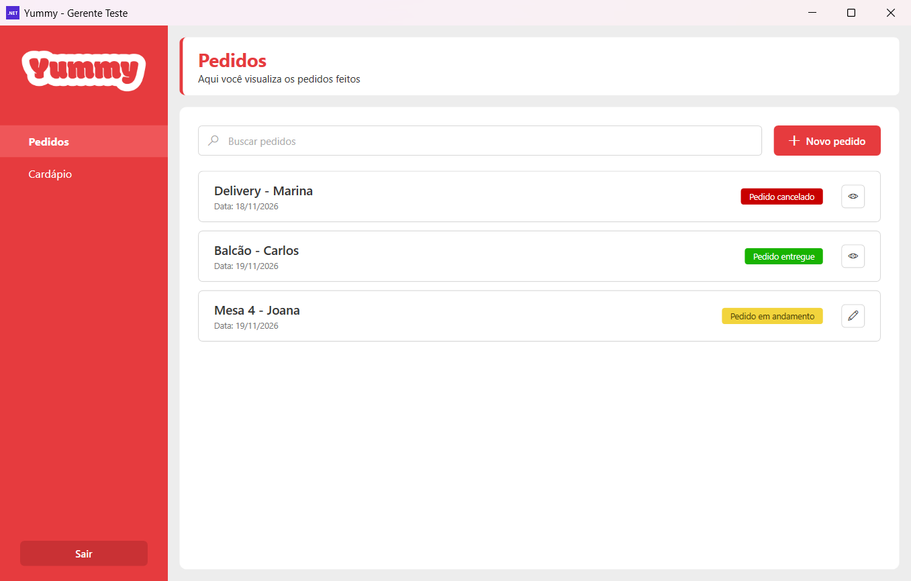
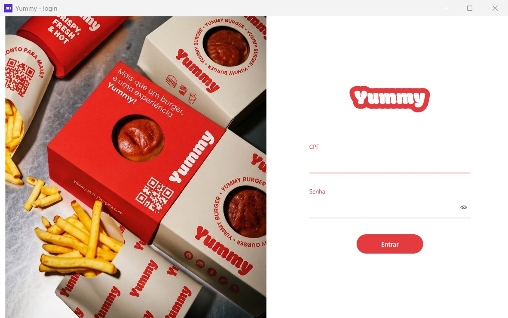
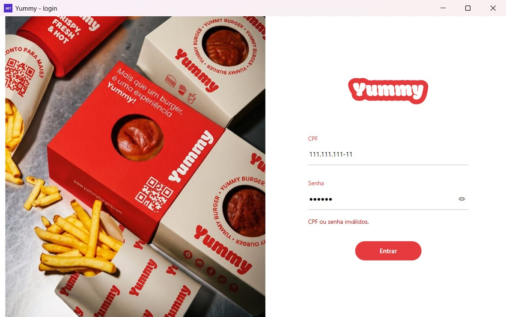
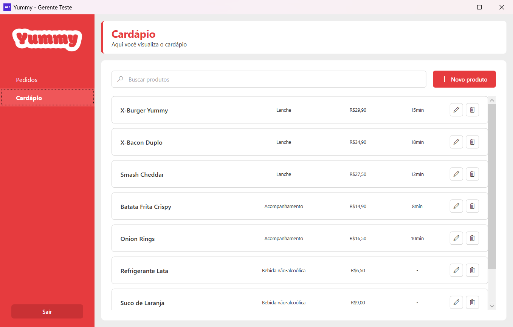
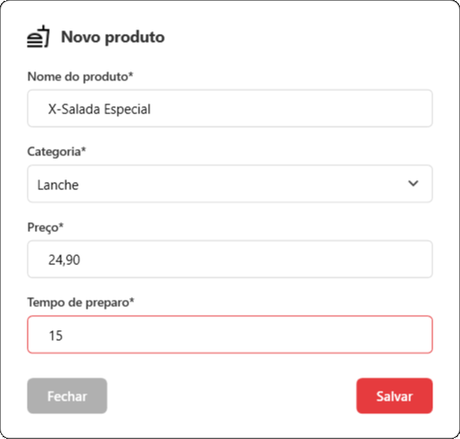
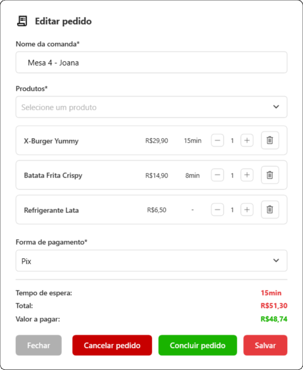
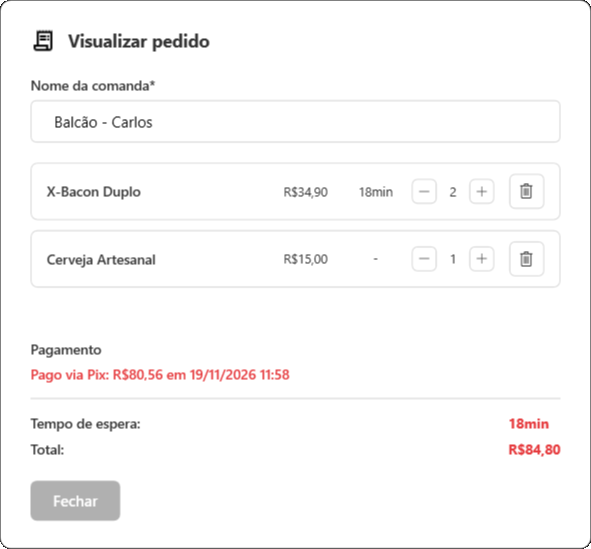
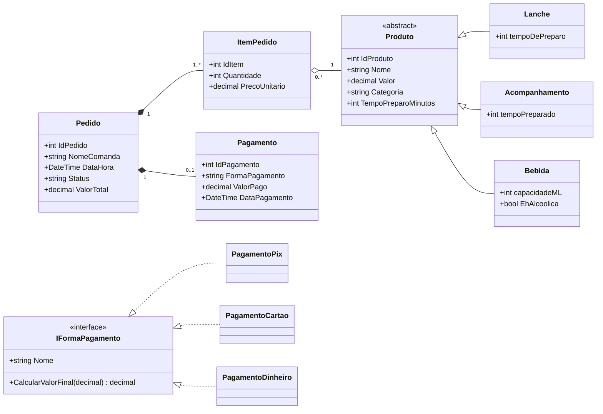

<h1 align="center">🍔 Yummy – Sistema de Delivery de Balcão</h1>

<p align="center">
  Sistema desktop para o atendimento de balcão de uma hamburgueria: cardápio, pedidos (comandas) e pagamento com Pix, Cartão ou Dinheiro.<br>
  Desenvolvido em <b>C# / WPF / Entity Framework Core / SQL Server</b>, aplicando <b>MVC</b>, <b>SOLID</b>, <b>Clean Code</b> e o padrão <b>Strategy</b>.
</p>

<p align="center">
  
  
  
  
  
</p>

<p align="center">
  
</p>

---

## 📌 Sobre o projeto

O **Yummy** foi desenvolvido como Atividade Avaliativa da disciplina de **Programação Orientada a Objetos II (POO II)** do curso de Engenharia de Software da **UVV**.

O sistema é usado pelo atendente ou gerente no balcão: ele faz login, mantém o cardápio, abre comandas para os clientes, acompanha o total e o tempo de espera de cada pedido e, ao concluir, registra a forma de pagamento. O Pix tem 5% de desconto.

## 🚀 Funcionalidades

- **Login** por CPF e senha, com consulta **SQL escrita à mão** (ADO.NET)
- **Cardápio:** cadastrar, editar, buscar e excluir lanches, acompanhamentos e bebidas
- **Pedidos:** abrir comanda, adicionar produtos, alterar quantidades e remover itens
- **Cálculos automáticos:** total do pedido e tempo de espera (maior tempo de preparo entre os itens)
- **Concluir pedido** escolhendo **Pix, Cartão ou Dinheiro** (padrão Strategy, com desconto no Pix)
- **Cancelar pedido** e **visualizar** pedidos entregues ou cancelados, com o pagamento realizado
- **Busca** de pedidos pelo nome da comanda (SQL manual) e de produtos por nome ou categoria
- **Banco criado automaticamente** ao abrir o sistema (Code First + Migrations)

## 🖼️ Telas

<table>
  <tr>
    <td align="center"><br><sub>Login</sub></td>
    <td align="center"><br><sub>Mensagem de erro no login</sub></td>
  </tr>
  <tr>
    <td align="center"><br><sub>Pedidos com status</sub></td>
    <td align="center"><br><sub>Cardápio</sub></td>
  </tr>
</table>

<table>
  <tr>
    <td align="center"><br><sub>Cadastro de produto</sub></td>
    <td align="center"><br><sub>Pedido com Pix: desconto em "Valor a pagar"</sub></td>
    <td align="center"><br><sub>Pedido entregue com o pagamento</sub></td>
  </tr>
</table>

## 🏗️ Arquitetura (MVC)

```
LoginWindow / PedidosView / CardapioView / Modais         ← View (WPF)
                 │
                 ▼
AutenticacaoService / ProdutoService / PedidoService      ← Control (regras de negócio)
PagamentoService + Strategy (IFormaPagamento)
                 │
                 ▼
DeliveryDBContext (EF Core)  ·  LoginRepository (SQL)     ← DataBase
                 │
                 ▼
         SQL Server LocalDB  →  banco DeliveryDB
```

| Camada | Pasta | Responsabilidade |
|---|---|---|
| **Model** | `Model/` | Entidades: `Produto` (abstrata), `Lanche`, `Acompanhamento`, `Bebida`, `Pedido`, `ItemPedido`, `Pagamento`, `Usuario` |
| **View** | `View/` | Telas WPF. Só exibem dados e capturam eventos, sem regra de negócio |
| **Control** | `Control/` | Regras e validações; lançam `RegraDeNegocioException` com a mensagem para a tela |
| **DataBase** | `DataBase/` | `DeliveryDBContext` (Fluent API + seed), `ConexaoBanco` e `LoginRepository` (SQL manual) |

## 🗄️ Modelo de dados



| Relacionamento | Onde | Como |
|---|---|---|
| **Herança** | `Produto` → `Lanche`, `Acompanhamento`, `Bebida` | Classe abstrata + TPH (coluna `Discriminator`) |
| **1x1** | `Pedido` ↔ `Pagamento` | FK `PedidoId` com índice único |
| **1xN** | `Pedido` → `ItemPedido`, `Produto` → `ItemPedido` | FKs `PedidoId` e `ProdutoId` |
| **NxN** | `Pedido` ↔ `Produto` | Classe associativa `ItemPedido` (quantidade e preço) |
| **Composição** | `Pedido` ◆ `ItemPedido`, `Pedido` ◆ `Pagamento` | `OnDelete(Cascade)` |
| **Agregação** | `ItemPedido` ◇ `Produto` | `OnDelete(Restrict)` |

**Migrations (Code First):** `DeliveryBalcaoInicial` → `ConfiguraUsuarioESeed` → `AdicionaPagamento` → `AdicionaComandaPedido`

## 🧩 SOLID e Clean Code

| Princípio | Onde |
|---|---|
| **S** – Responsabilidade única | `LoginRepository` só acessa o banco; `AutenticacaoService` só valida o login; `ConexaoBanco` só guarda a conexão; cada forma de pagamento tem uma única regra |
| **O** – Aberto/Fechado | Nova forma de pagamento = nova classe que implementa `IFormaPagamento`, sem alterar os serviços |
| **L** – Substituição de Liskov | `Lanche`, `Acompanhamento` e `Bebida` funcionam onde se espera um `Produto` (lista, `ItemPedido`, cálculo do tempo) |
| **I** – Segregação de interfaces | Interfaces pequenas: `IUsuarioRepository` (1 método) e `IFormaPagamento` (2 membros) |
| **D** – Inversão de dependência | `AutenticacaoService` recebe `IUsuarioRepository` pelo construtor; `PagamentoService` depende de `IFormaPagamento` |

**Clean Code:**
- Nomes que explicam a intenção (`CalcularTempoEspera`, `BuscarEmAndamento`)
- Métodos curtos (`LerPreco`, `CriarPorCategoria`)
- Constantes em vez de textos e números soltos (`StatusPedido`, `CategoriaProduto`, `PercentualDesconto`)
- Cláusulas de guarda (o método valida e sai logo no início)
- Exceção de domínio única (`RegraDeNegocioException`)
- Parâmetros SQL contra SQL Injection
- `using` para liberar conexões
- Camadas separadas por namespace

## 🛠️ Tecnologias

| Tecnologia | Versão |
|---|---|
| C# / .NET (WPF) | .NET 10 (`net10.0-windows`) |
| Entity Framework Core (+ SqlServer, Tools, Design) | 10.0.10 |
| Microsoft.Data.SqlClient (SQL manual) | 7.1.2 |
| SQL Server LocalDB | MSSQLLocalDB |

## ▶️ Como executar

**Pré-requisitos:** Visual Studio com a carga de trabalho **Desenvolvimento para desktop com .NET** e o componente **SQL Server Express LocalDB**. Para conferir o LocalDB:

```bash
sqllocaldb info
```

1. Clone o repositório:
   ```bash
   git clone https://github.com/yalicerm/sistema-delivery.git
   ```
2. Abra `SistemaDelivery/SistemaDelivery.slnx` no Visual Studio.
3. Pressione **F5**. Na primeira execução o sistema cria o banco `DeliveryDB` e aplica as migrations sozinho.
4. Entre com um dos usuários de teste:

| Cargo | CPF | Senha |
|---|---|---|
| Gerente | `111.111.111-11` | `gerente123` |
| Atendente | `222.222.222-22` | `atendente123` |

> As senhas ficam em texto puro por simplicidade acadêmica. Em um sistema real, elas seriam guardadas com hash.

## 📁 Estrutura de pastas

```
SistemaDelivery/
├── App.xaml(.cs)        Início: cultura pt-BR, cria o banco e abre o login
├── Model/               Entidades + constantes (StatusPedido, CategoriaProduto)
├── DataBase/            DeliveryDBContext, ConexaoBanco, IUsuarioRepository, LoginRepository
├── Control/             Serviços, RegraDeNegocioException e FormasPagamento/ (Strategy)
├── View/                Telas WPF, Converters, Styles e Assets
└── Migrations/          Gerado pelo Entity Framework (Code First)
```

## 👩‍💻 Equipe

| Integrante | Responsabilidade principal |
|---|---|
| Alice Resende | Banco de dados, entidades, migrations, login com SQL manual, pagamento e integração |
| Luisa Mello | Telas WPF, identidade visual e serviços ligados às telas |
| Nicole Bassani | |

## 🤖 Uso de Inteligência Artificial (Nível IA-2)

A IA foi usada como ferramenta de apoio sob supervisão humana contínua. Ela ajudou no diagnóstico de erros (por exemplo, os erros de compilação que impediam o `Add-Migration`), na revisão do código e na geração inicial de alguns trechos. Todo o código foi revisado, testado e adaptado pela equipe. As decisões de projeto e o domínio da solução são das autoras. Os detalhes, com os prompts e a comparação de um trecho com e sem IA, estão na documentação oficial do projeto.

## 📄 Licença

Distribuído sob a licença MIT. Veja [LICENSE](LICENSE).
